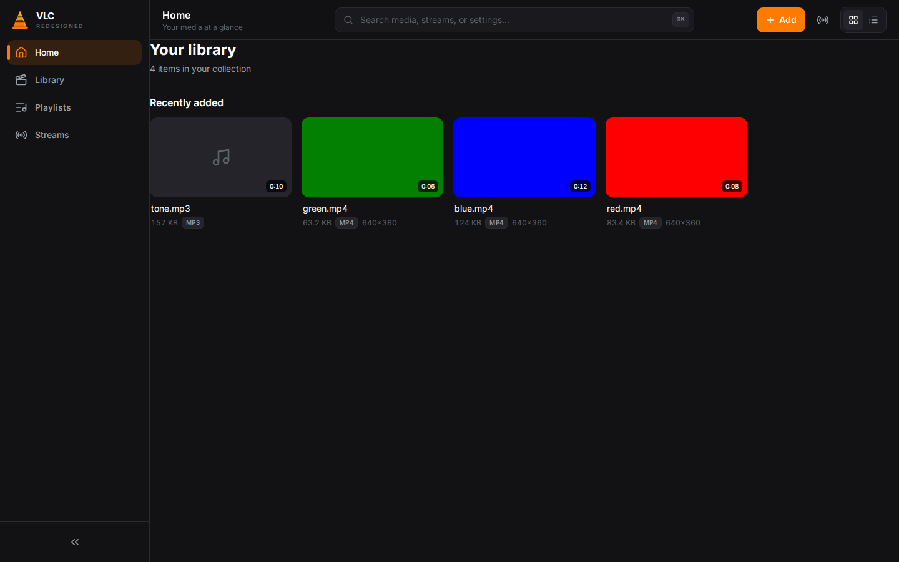
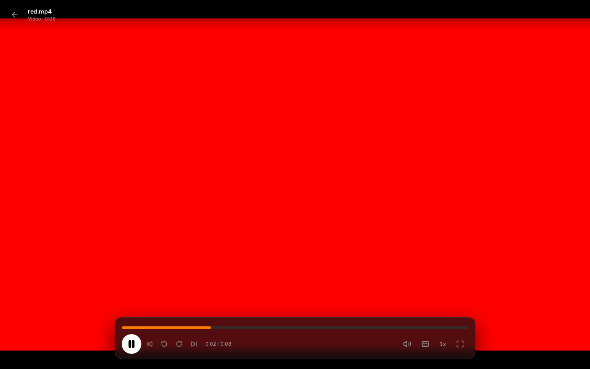
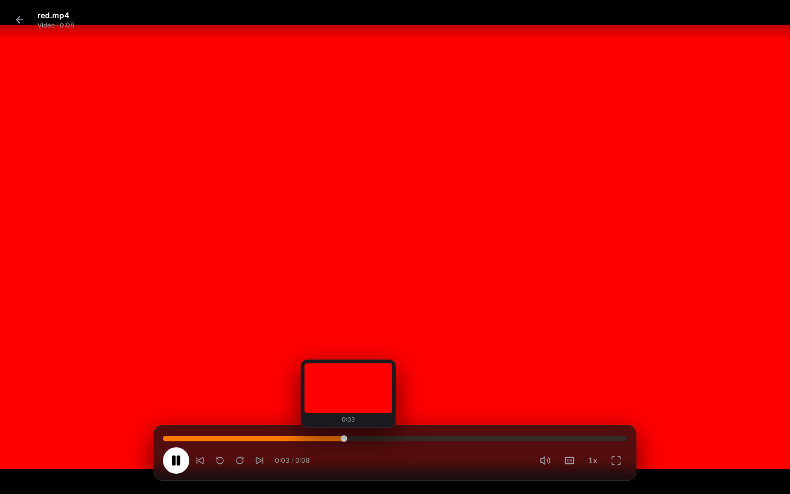
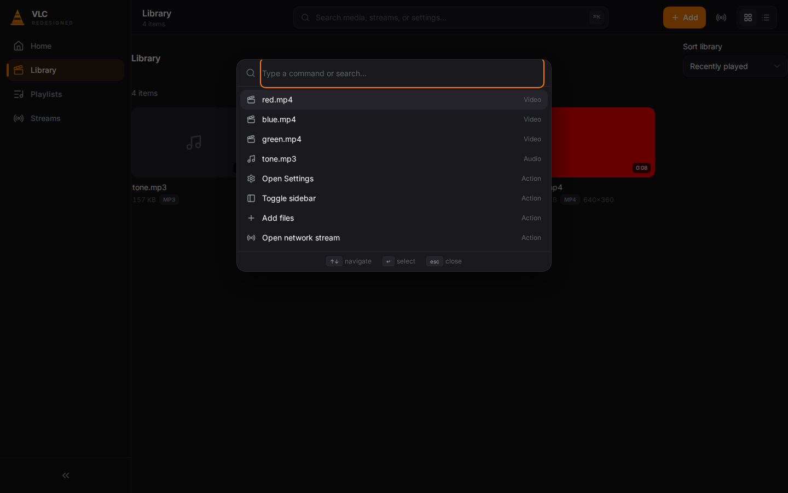
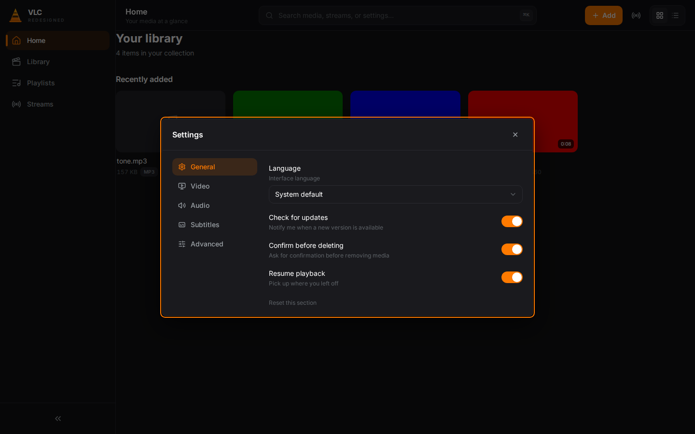
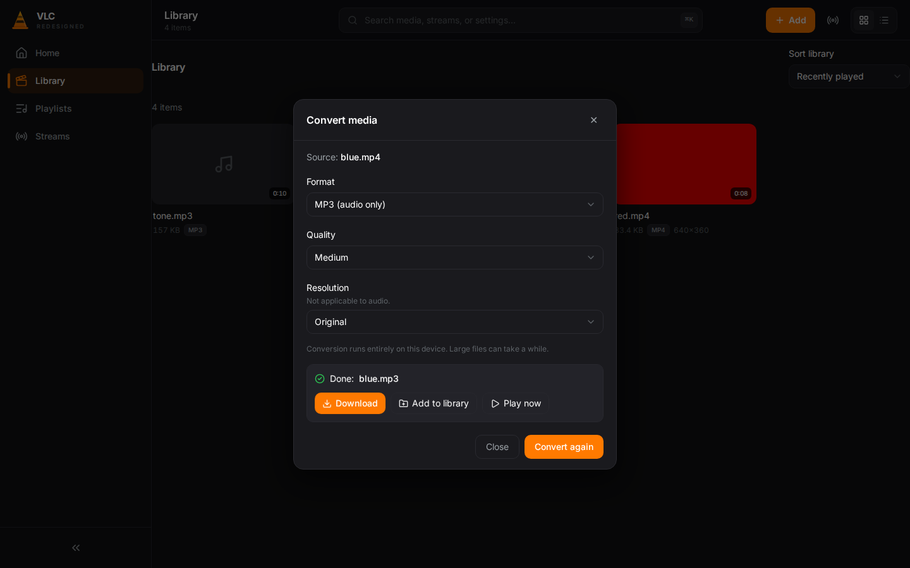

# VLC · Redesigned

VLC Media Player, rebuilt around a modern interface. This repo implements
[Juxtopposed's VLC redesign concept](https://www.youtube.com/watch?v=ERFeOgqk324)
([Figma file](https://www.figma.com/community/file/1691465999134370980/vlc-redesign))
as a real, working, cross-platform media player: dark-first design system,
sidebar navigation, media library with generated thumbnails, playlists,
network streams, a floating glass playbar, and client-side media conversion.



## Screens

| | |
|---|---|
|  |  |
| *Floating glass playbar over video* | *Thumbnail tooltip on the seek bar* |
|  |  |
| *Cmd/Ctrl+K palette: media, streams, actions* | *Tabbed settings: toggles, selects, steppers* |
|  | |
| *Real on-device conversion via ffmpeg.wasm* | |

## Features

- **Design system**: tokenized dark theme (obsidian surfaces, VLC amber accent),
  Inter typography, 16/12/10px radius scale, 200ms ease-out micro-interactions.
- **Sidebar**: collapsible (240px / 72px), active pill indicator, Home, Library,
  Playlists, Streams.
- **Library**: grid/list views, sorting, global search, real thumbnails generated
  from your files, duration badges, resume-progress overlays, audio artwork.
- **Player**: floating glassmorphic playbar, morphing play/pause, ±10s skip,
  scrubber with hover thumbnail previews, volume popover, subtitle/audio track
  menu (load `.srt`/`.vtt` sidecars), 0.5x–2.0x speed, fullscreen, auto-hiding
  controls, full keyboard control.
- **Playlists**: create, rename, delete, add via context menu or submenu.
- **Streams**: save network URLs, HLS (`.m3u8`) support via hls.js.
- **Convert**: transcode to MP4 / WebM / MP3 with quality and resolution options.
  Runs 100% on-device with ffmpeg.wasm. Nothing is uploaded.
- **Command palette** (`Ctrl/Cmd+K`): jump to media, streams, settings, actions.
- **Context menus**: Play, Add to Playlist, Open File Location, Convert/Stream,
  Properties, Delete, each with icons and keyboard support.
- **Persistence**: library metadata and file bytes in IndexedDB, settings in
  localStorage. Close the tab, your library is still there.
- **Accessibility**: ARIA labels and roles throughout, keyboard-operable cards,
  slider and menus, visible focus rings, focus-trapped dialogs.

## Quickstart

```bash
npm install
npm run dev      # web app at http://localhost:5173
```

Add files with the **Add** button or drag and drop them anywhere into the app.
Sample clips live in `public/samples/` if you want something to try instantly.

```bash
npm test         # unit tests (vitest)
npm run build    # production build to dist/
```

### Desktop app (Tauri)

```bash
npm run tauri dev     # needs the Rust toolchain
npm run tauri build    # .exe / .dmg / .AppImage
```

The Tauri shell in `src-tauri/` is thin: window config, bundling, icons
(generated by `npm run icons`). No Rust build is needed for web development.

## Keyboard shortcuts

| Keys | Action |
|---|---|
| `Ctrl/⌘ K` | Command palette |
| `Space` | Play / pause |
| `←` `→` | Seek back/forward (Shift: larger steps) |
| `↑` `↓` | Volume |
| `F` | Fullscreen |
| `M` | Mute |
| `N` / `P` | Next / previous in queue |
| `Esc` | Close menu, dialog, palette, player |

## Architecture

```
src/
  theme/tokens.css      # the entire design system (Tailwind v4 @theme)
  components/ui.tsx     # shared primitives: buttons, toggles, dialogs...
  components/           # Sidebar, TopBar, MediaCard, modals, player/*
  views/                # Home, Library, Playlists, Streams, Player
  stores/               # zustand: library, player, settings, ui
  lib/                  # media probing, thumbnails, subtitles, transcode, db
  hooks/                # global keyboard shortcuts
```

Key decisions:

- **Playback is HTML5 video.** That keeps one codebase for web and desktop and
  makes every UI behavior real. The tradeoff is codec support: whatever the
  browser (or WebView) can decode. Exotic containers still need desktop VLC.
- **Files are stored as blobs in IndexedDB**, so the library survives reloads
  with zero backend. Very large collections will use significant browser storage.
- **Heavy engines lazy-load**: hls.js only for `.m3u8` streams, ffmpeg.wasm only
  when Convert opens. The main bundle stays around 300 KB.
- **The `<video>` element registers itself** in the player store; every control
  drives playback through store actions, and element events sync back.

The full agent implementation spec this repo was built from is in
[docs/SPEC.md](docs/SPEC.md).

## Limitations (honest)

- Codec support follows the browser, not libvlc. No DVD/Blu-ray, no exotic codecs.
- "Open File Location" explains itself: web-imported files live in IndexedDB.
- Loudness normalization toggle is stored but needs a WebAudio graph to act on.
- Subtitle styling follows the Subtitles settings tab.

## Credits

- Interface concept: [Juxtopposed](https://www.youtube.com/@juxtopposed) ("I Redesigned
  VLC After 25 Years"). This is an independent implementation of that concept,
  not affiliated with VideoLAN.
- VLC and the traffic cone are trademarks of VideoLAN. The cone mark here is an
  original minimalist drawing, not VLC's logo.

## License

MIT. See [LICENSE](LICENSE).
